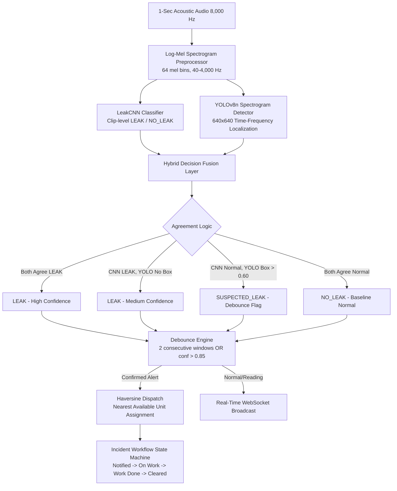

# Water Leak Monitoring System – AquaGuard AI

An acoustic pipe monitoring and emergency dispatch system for municipal water utilities. Built with a **Hybrid Neural Architecture** combining a clip-level PyTorch Convolutional Neural Network (LeakCNN) with an Ultralytics YOLOv8n Spectrogram Object Detector, a Decision Fusion layer, a Debounce Engine, Haversine dispatch, FastAPI WebSockets, and a modern React supervisory dashboard.

---

## Hybrid System Architecture



---

## Key Features

1. **Hybrid CNN + YOLO Acoustic Detection**
   - **LeakCNN (Existing)**: 4-block PyTorch CNN classifier evaluating whole-clip acoustic features.
   - **YOLOv8n (New)**: Object detector running on 640x640 log-mel spectrogram images of the same 1-second clip, localizing acoustic leak signatures as bounding boxes ($t_{start}, t_{end}, f_{low}, f_{high}$) with confidence scores.
   - **Decision Fusion Layer**: Unifies dual-model outputs across 4 consensus states, preventing false alerts while localizing leak signatures in time and frequency.
   - **Missing Weights Fallback**: If YOLO weights are absent, the application gracefully degrades to CNN-only mode without crashing.

2. **Debounce Filter**
   - Evaluates the fused confidence score.
   - Suppresses transient hydraulic noise by requiring either 2 consecutive LEAK windows or a single-window fused confidence $> 0.85$.

3. **Emergency Dispatch Assignment**
   - Computes Haversine geodesic distances to all registered maintenance teams.
   - Automatically assigns the nearest available unit with driving ETA estimation.

4. **Incident Workflow Management**
   - Enforces sequential progression: `Notified` -> `On Work` -> `Work Done` -> `Cleared`.
   - Clearing an alert marks the assigned unit available and resets the sensor to normal.
   - Logs timestamped state transitions and operator audit notes.

5. **Supervisory Dashboard & Model Performance**
   - **Dashboard Map**: Circle markers for leak alerts and sensors, square markers for maintenance units, and dispatch route lines.
   - **Alert Feed**: Displays the log-mel spectrogram with YOLO bounding boxes drawn on it, plus CNN confidence, YOLO confidence, and fused confidence badges.
   - **Model Performance Page**: Complete benchmark table comparing CNN-only vs YOLO-only vs Fused metrics, agreement rules matrix, and YOLO diagnostic plots (Confusion Matrix, PR Curve, Sample Detections).

6. **Sensors Registry**
   - Overview of all acoustic nodes with status stat boxes (Total, Normal, Leak, Offline).
   - Compact table with last reading timestamp, total alerts, and confidence score.
   - Search by ID/name, status filter, and detail side panel with alert history and "Show on map" navigation.

7. **Teams Fleet Management**
   - Unit availability status boxes (Total, Available, Busy).
   - Table detailing current alert assignments, jobs completed, and average repair times.
   - Drill-down past job logs with response and repair durations.

8. **Operational Reports**
   - Audited table of resolved incidents with response times (notified - detected) and repair times (work_done - on_work).
   - Multi-criteria filtering by date range, sensor, and maintenance team.
   - Summary totals row and client-side CSV export.

9. **Analytics and Admin**
   - Operational response metrics, confusion matrix table, ROC discrimination curve, and per-sensor alert distributions.
   - Admin panel with coordinate picker map and asset provisioning forms.

---

## Screenshots

<!-- Screenshot Placeholders -->
- *Dashboard (Map and Incident Feed)*: `[Placeholder: docs/screenshots/dashboard.png]`
- *Alerts Table*: `[Placeholder: docs/screenshots/alerts.png]`
- *Sensors Registry & Detail Panel*: `[Placeholder: docs/screenshots/sensors.png]`
- *Teams Fleet & Past Jobs*: `[Placeholder: docs/screenshots/teams.png]`
- *Operational Reports & CSV Export*: `[Placeholder: docs/screenshots/reports.png]`
- *Analytics & Confusion Matrix*: `[Placeholder: docs/screenshots/analytics.png]`
- *Admin Provisioning*: `[Placeholder: docs/screenshots/admin.png]`

---

## Quickstart Guide

### 1. Prerequisites
- Python 3.10+
- Node.js 18+ and npm

### 2. Backend Setup
Install Python dependencies:
```bash
pip install -r requirements.txt
```

Run unit tests (core logic and report calculations):
```bash
python -m unittest tests/test_core.py tests/test_reports.py
```

Start the FastAPI backend:
```bash
python -m uvicorn backend.main:app --host 0.0.0.0 --port 8000 --reload
```
API Documentation: **http://localhost:8000/docs**

### 3. Frontend Setup
In a new terminal:
```bash
cd frontend
npm install
npm run dev
```
Open **http://localhost:5173** in a browser.

### 4. Windows Launch Script
Run:
```powershell
.\run.ps1
```

---

## Dataset and Model Details

- **Leak Class**: 500 audio recordings (1.0s each @ 8,000 Hz, mono) across 276 parent recording instances.
- **Normal Class**: 386 audio recordings (1.0s each @ 8,000 Hz, mono) across 71 parent recording instances.
- **Split Strategy**: Grouped by parent recording ID to prevent data leakage:
  - Train: 242 recordings (606 audio windows: 335 LEAK, 271 NO_LEAK)
  - Validation: 52 recordings (153 audio windows: 92 LEAK, 61 NO_LEAK)
  - Test: 53 recordings (127 audio windows: 73 LEAK, 54 NO_LEAK)

### Note on YOLO Training Pseudo-Labels
> **Auto-Generated Pseudo-Labels**: Bounding box annotations in `ml/yolo_dataset/labels/{train,val,test}` are pseudo-labels auto-generated by `ml/make_spectrogram_images.py`. For LEAK clips, high-energy time-frequency resonance regions are extracted via energy thresholding, 2D binary morphological opening/closing cleanup, and connected component bounding box estimation. NO_LEAK clips receive empty label files (pure background).

### Machine Learning Workflows
1. **Convert audio clips to 640x640 log-mel spectrograms & generate YOLO pseudo-labels**:
   ```bash
   python ml/make_spectrogram_images.py
   ```
2. **Train / Fine-Tune YOLOv8n detector on CPU/GPU**:
   ```bash
   python ml/train_yolo.py
   ```
   Exports:
   - `ml/artifacts/yolo_leak.pt` (Best fine-tuned weights)
   - `ml/artifacts/yolo_metrics.json` & `ml/artifacts/model_comparison.json`
   - `ml/artifacts/yolo_confusion_matrix.png`, `ml/artifacts/yolo_pr_curve.png`, `ml/artifacts/yolo_training_curves.png`
3. **Train baseline CNN classifier (optional)**:
   ```bash
   python ml/train.py
   ```

---

## API Endpoints

| Method | Endpoint | Description |
|---|---|---|
| `POST` | `/api/predict` | Upload audio file (`.wav`) for **hybrid CNN + YOLO** inference. Returns `label`, `confidence`, `cnn_confidence`, `yolo_confidence`, `fused_confidence`, `yolo_detections`, `spectrogram_image` (base64) |
| `POST` | `/api/sensors/{id}/reading` | Ingest acoustic clip from a sensor; runs hybrid CNN + YOLO detection, feeds fused confidence to Debounce filter, and dispatches nearest team if confirmed |
| `GET` | `/api/model-comparison` | Retrieve benchmark comparison metrics (CNN-only vs YOLO-only vs Fused) on the independent test set |
| `GET` | `/api/sensors` | List all sensors with status and coordinates |
| `GET` | `/api/sensors/{id}/alerts` | List historical alerts for a specific sensor |
| `POST` | `/api/sensors` | Register new sensor |
| `GET` | `/api/teams` | List maintenance teams and statuses |
| `GET` | `/api/teams/{id}/jobs` | List past and active jobs for a specific team |
| `GET` | `/api/alerts` | List incidents (filter: `active` or `resolved`) |
| `POST` | `/api/alerts/{id}/status` | Transition status (`notified`, `on_work`, `work_done`, `cleared`) |
| `POST` | `/api/simulator/trigger-leak`| Force simulated leak on a sensor |
| `POST` | `/api/simulator/toggle` | Toggle virtual sensor background stream |
| `GET` | `/api/reports` | Retrieve filtered incident reports with response and repair times |
| `GET` | `/api/analytics` | Retrieve KPIs and evaluation metrics |
| `WS` | `/ws` | WebSocket broadcast stream |
